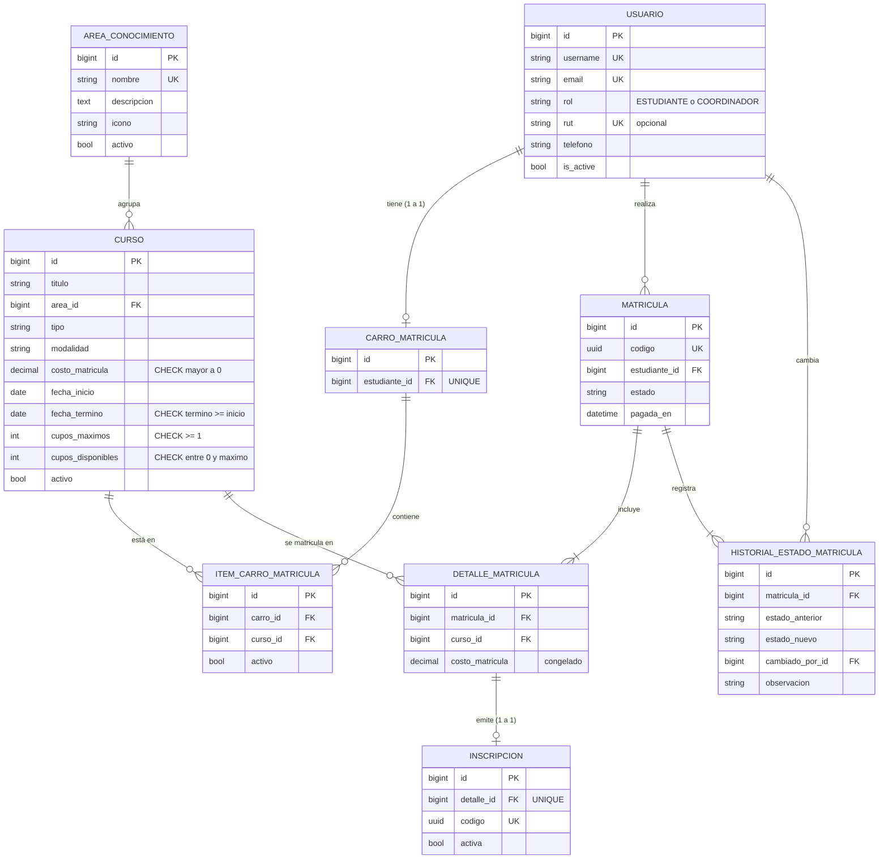

# CodeLab Academy · Plataforma de reservas de cursos y bootcamps

Proyecto EVA-2 de **Desarrollo Backend** — Caso 2.
**Alumna:** Catalina Quezada Sanzana · **Sección:** IEC-N4-C2 · **Año:** 2026

Sistema de matrícula para una academia tecnológica. Los **estudiantes** arman un **carro de matrícula persistente** (guardado en PostgreSQL, relación 1 a 1) y lo confirman. En la confirmación se valida que cada curso tenga al menos un cupo libre; si hay disponibilidad, la matrícula pasa a **PAGADO**, se descuenta un cupo por curso de forma atómica y se emiten **inscripciones oficiales con código UUID**. El **Coordinador Académico** administra áreas y cursos y cambia el estado de las matrículas. Si cancela una matrícula pagada, los cupos se liberan automáticamente.

---

## Stack tecnológico

| Componente | Versión |
|---|---|
| Python | 3.12.0 |
| Django | 5.2.17 (LTS, soporte hasta 2028) |
| Django REST Framework | 3.18.1 |
| djangorestframework-simplejwt (+ token_blacklist) | 5.5.1 |
| django-filter | 26.1 |
| drf-spectacular (OpenAPI 3, Swagger UI, ReDoc) | 0.30.0 |
| psycopg (driver PostgreSQL 3) | 3.3.6 |
| python-decouple | 3.8 |
| PostgreSQL | 18.6 |
| Bootstrap / Bootstrap Icons (CDN jsdelivr) | 5.3.8 / 1.13.1 |

Las versiones exactas de todas las dependencias están fijadas en `requirements.txt`.

---

## Estructura

```
academia-bootcamps/
├── academia_bootcamps/   settings.py, urls.py (catch-all + handler404), wsgi.py, asgi.py
├── core/                 inicio, panel, documentación, redirección, context processor,
│                         middleware, manejador de errores de la API, filtro |clp,
│                         comandos seed_data y simular_concurrencia
├── usuarios/             Usuario, JWT con claims (tokens.py), permisos por rol, señal del carro
├── cursos/               AreaConocimiento, Curso, CursoFilter, API y vistas HTML
├── carro/                CarroMatricula, ItemCarroMatricula, servicios del carro
├── matriculas/           Matricula, DetalleMatricula, Inscripcion, Historial, servicios de cupos
├── templates/            base.html, parciales/, páginas por app, Swagger/ReDoc/Browsable API con footer
└── static/               css/tema.css (paleta), js/app.js, img/favicon.svg
```

---

## Modelo de datos (3.ª forma normal)



- **1FN:** todos los valores son atómicos (nada de listas en columnas).
- **2FN / 3FN:** el curso guarda solo la FK del área; el ítem del carro no guarda el costo; la inscripción no repite estudiante ni curso (se obtienen por el detalle); los totales se calculan con `Sum`, nunca se guardan. El costo del detalle es un **hecho histórico** (precio pagado ese día), no una dependencia transitiva.
- **Restricciones en la BD:** `UniqueConstraint` (cohorte única por título + fecha, `curso_unico_por_carro`, curso único por matrícula, RUT único si existe) y `CheckConstraint(condition=...)` (costo > 0, término ≥ inicio, cupos ≥ 1, `0 <= cupos_disponibles <= cupos_maximos`).
- **Borrado lógico:** "eliminar" = `activo=False` (usuarios: `is_active=False`). Las relaciones de negocio usan `on_delete=PROTECT`.

---

## Instalación paso a paso (Windows PowerShell)

> Requisitos: Python 3.12 (o 3.13) y PostgreSQL 18 (o 16+) instalados.

```powershell
# 1. Clonar y entrar al proyecto
git clone https://github.com/<tu-usuario>/academia-bootcamps.git
cd academia-bootcamps

# 2. Crear y activar el entorno virtual
py -3.12 -m venv venv
.\venv\Scripts\Activate.ps1
# (si PowerShell bloquea scripts: Set-ExecutionPolicy -Scope CurrentUser RemoteSigned)

# 3. Instalar dependencias
pip install -r requirements.txt

# 4. Crear el archivo .env a partir de la plantilla y completar la contraseña
Copy-Item .env.example .env
notepad .env

# 5. Crear el rol "catalina" (con CREATEDB) y la base academia_bootcamps_db (UTF8)
#    Se ejecuta como superusuario postgres; pide su contraseña.
& "C:\Program Files\PostgreSQL\18\bin\psql.exe" -U postgres -h localhost -f crear_bd.sql

# 6. Crear las tablas
python manage.py migrate

# 7. Cargar datos de prueba (idempotente; --reset desactiva y recarga)
python manage.py seed_data

# 8. Levantar el servidor
python manage.py runserver
#    Sitio:    http://127.0.0.1:8000/
#    Swagger:  http://127.0.0.1:8000/api/docs/
#    ReDoc:    http://127.0.0.1:8000/api/redoc/

# 9. Ejecutar las pruebas automatizadas (crean una BD temporal: requiere CREATEDB)
python manage.py test

# 10. Demostración de concurrencia (dos estudiantes, un solo cupo)
python manage.py simular_concurrencia
```

> El rol de la base necesita `CREATEDB` para que `manage.py test` cree `test_academia_bootcamps_db`; `crear_bd.sql` ya lo otorga.

---

## Credenciales de prueba

| Usuario | Contraseña | Rol | Situación en los datos de prueba |
|---|---|---|---|
| `coordinador` | `Coordinador2026!` | Coordinador Académico | Administra la oferta y los estados |
| `estudiante1` | `Estudiante2026!` | Estudiante | Matrícula pagada + carro con un bootcamp **agotado** (confirmar → 409) |
| `estudiante2` | `Estudiante2026!` | Estudiante | Matrícula pagada, una pendiente y carro con el **último cupo** de un taller |
| `estudiante3` | `Estudiante2026!` | Estudiante | Matrículas completada, pagada y cancelada |

---

## Endpoints y permisos

| Método | Endpoint | Permiso |
|---|---|---|
| GET | `/api/` | Público |
| POST | `/api/auth/registro/` | Público (crea siempre ESTUDIANTE) |
| POST | `/api/auth/login/` | Público (devuelve access, refresh, rol y usuario) |
| POST | `/api/auth/refresh/` | Público (con refresh válido) |
| POST | `/api/auth/logout/` | Autenticado (blacklist del refresh) |
| GET | `/api/auth/perfil/` | Autenticado |
| GET | `/api/areas/`, `/api/areas/{id}/` | **Público** |
| POST/PUT/PATCH/DELETE | `/api/areas/…`, POST `/api/areas/{id}/reactivar/` | Coordinador |
| GET | `/api/cursos/`, `/api/cursos/{id}/` (filtros, búsqueda, orden, paginación) | **Público** |
| POST/PUT/PATCH/DELETE | `/api/cursos/…`, POST `/api/cursos/{id}/reactivar/` | **Coordinador** |
| GET/POST/DELETE | `/api/carro-matricula/` | **Estudiante** |
| DELETE | `/api/carro-matricula/items/{curso_id}/` | Estudiante |
| POST | `/api/matriculas/confirmar/` | **Estudiante** |
| GET | `/api/mis-matriculas/`, `/api/mis-matriculas/{id}/` | **Estudiante** (solo las propias) |
| GET | `/api/matriculas/`, `/api/matriculas/{id}/` | Coordinador |
| PATCH | `/api/matriculas/{id}/estado/` | **Coordinador** |
| GET | `/api/inscripciones/` | Coordinador |
| CRUD | `/api/usuarios/`, POST `/{id}/reactivar/`, GET `/{id}/carro-matricula/` | Coordinador |

Sin token → **401**. Con token pero con otro rol → **403**. Errores en JSON uniforme: `{"error": true, "mensaje": "...", "detalle": ...}`.

**Filtros de `/api/cursos/`:** `area`, `area_nombre`, `tipo`, `modalidad`, `costo_min`, `costo_max`, `inicio_desde`, `inicio_hasta`, `con_cupos`, `search`, `ordering`, `page`, `incluir_inactivos` (coordinador).
**Filtros de `/api/matriculas/`:** `estado`, `estudiante`, `curso`, `fecha_desde`, `fecha_hasta`.

---

## Cómo probar en Swagger

1. Abre `http://127.0.0.1:8000/api/docs/`.
2. **Login:** `POST /api/auth/login/` → `{"username": "estudiante2", "password": "Estudiante2026!"}` → copia `access`.
3. **Authorize:** botón *Authorize* → pega el token → *Authorize* (queda guardado gracias a `persistAuthorization`).
4. **Carro:** `GET /api/carro-matricula/` → `POST /api/carro-matricula/` con `{"curso": <id>}`. Repite el mismo curso para ver el **400** "Este curso ya está en tu carro de matrícula".
5. **Confirmar:** `POST /api/matriculas/confirmar/` → **201** con la matrícula `PAGADO` y los códigos UUID. Con `estudiante1` verás el **409** por falta de cupo.
6. **Cambiar estado:** login como `coordinador`, *Authorize* con su token y `PATCH /api/matriculas/{id}/estado/` con `{"estado": "CANCELADO"}` → los cupos vuelven a quedar disponibles. Intentar `{"estado": "PAGADO"}` sobre una cancelada → **400**.

---

## Interfaz HTML (sin login)

| Ruta | Página |
|---|---|
| `/` | Portada con estadísticas reales y próximos cursos |
| `/cursos/`, `/cursos/<id>/` | Oferta académica con los filtros de `CursoFilter` y detalle |
| `/panel/` | Panel de gestión |
| `/panel/areas/`, `/panel/cursos/`, `/panel/usuarios/` | CRUD completo con baja lógica y reactivación |
| `/panel/carros/?estudiante=<id>` | Carro persistido: agregar, quitar, vaciar y confirmar |
| `/panel/matriculas/`, `/panel/inscripciones/` | Matrículas con historial y cambio de estado; inscripciones UUID |
| `/documentacion/` | Guía del sistema |

Las rutas inexistentes (`/asdf`, `/api/xyz`, `/panel/cursos/999999/`, incluso `/static/noexiste.css` gracias al `runserver` propio de `core`) nunca muestran el 404 de Django: terminan en una pantalla que vuelve al inicio en 3 segundos. `/cursos` redirige a `/cursos/`.

---

## Uso de IA en el desarrollo

Este proyecto se desarrolló con apoyo de **Claude Code** (asistente de programación de Anthropic) a partir de un enunciado detallado preparado por la alumna. La IA generó el código, las pruebas y la documentación, y ejecutó cada módulo sobre PostgreSQL real (migraciones, `manage.py check`, pruebas, peticiones HTTP y revisión visual de las páginas) corrigiendo los errores encontrados. La alumna definió los requisitos, la paleta de colores y el estilo visual, y es responsable de revisar, comprender y defender cada decisión técnica (ver `DEFENSA.md`).
